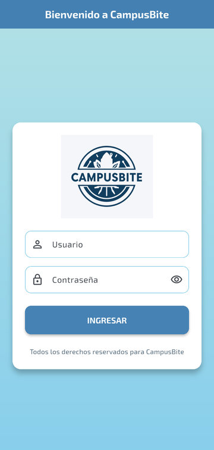
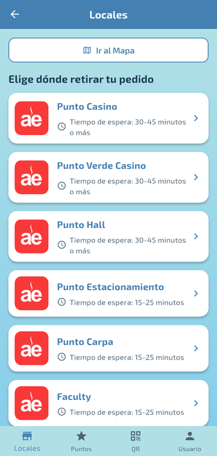
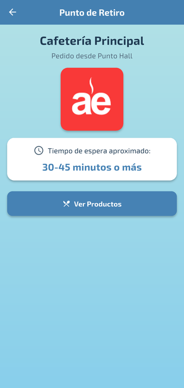
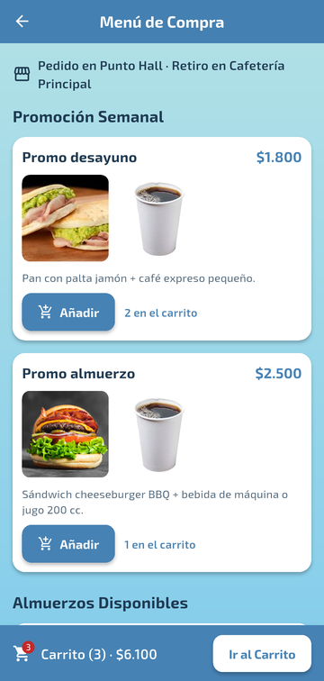
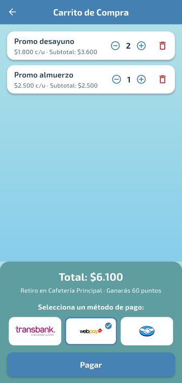
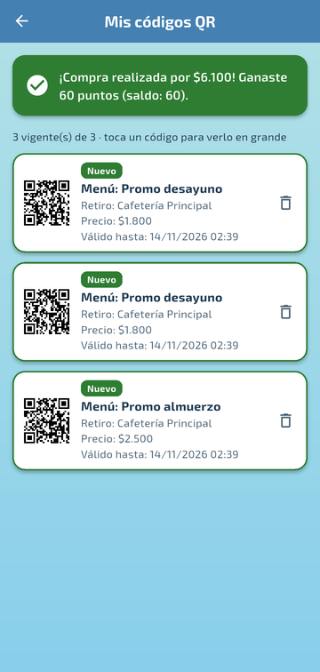
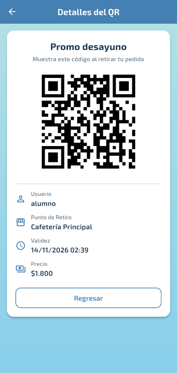
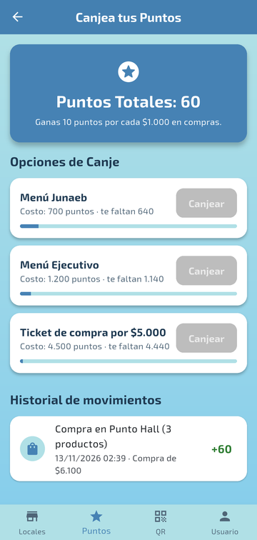
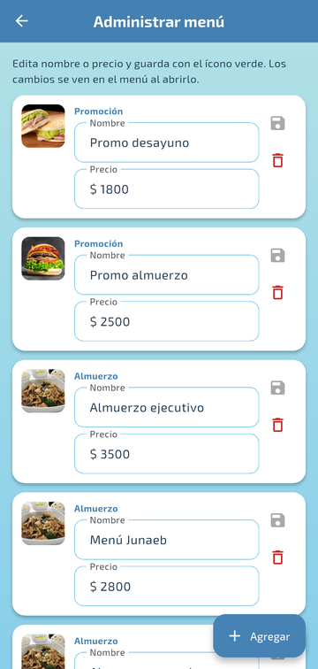
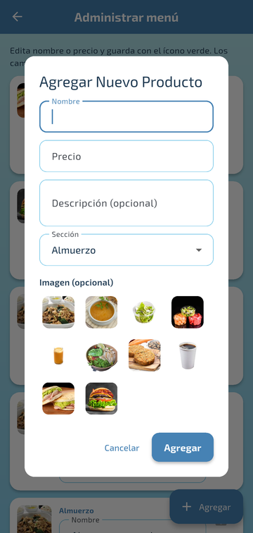

# CampusBIT

Aplicación móvil y web hecha en **Flutter** para pedir comida en los locales AE de un campus universitario. Eliges un local, revisas el menú, pagas desde un carrito y recibes un **código QR** por cada producto para retirarlo en la **Cafetería Principal**, que es el único punto de retiro. Cada compra suma **puntos**, que después se canjean por premios.

> **Proyecto académico.** Es un prototipo funcional para un curso universitario y **no está pensado para producción**: el login no verifica contraseñas reales, el pago es simulado y todos los datos se guardan localmente en el dispositivo o en el navegador.

<table>
  <tr>
    <td align="center"><br><sub><b>Login</b></sub></td>
    <td align="center"><br><sub><b>Locales</b></sub></td>
  </tr>
  <tr>
    <td align="center"><br><sub><b>Punto de retiro</b></sub></td>
    <td align="center"><br><sub><b>Menú</b></sub></td>
  </tr>
  <tr>
    <td align="center"><br><sub><b>Carrito</b></sub></td>
    <td align="center"><br><sub><b>Códigos QR</b></sub></td>
  </tr>
  <tr>
    <td align="center"><br><sub><b>Detalle del QR</b></sub></td>
    <td align="center"><br><sub><b>Puntos</b></sub></td>
  </tr>
  <tr>
    <td align="center"><br><sub><b>Administración</b></sub></td>
    <td align="center"><br><sub><b>Nuevo producto</b></sub></td>
  </tr>
</table>

<sub>Capturas tomadas en un emulador Android (API 37).</sub>

---

## Cómo se usa

1. **Inicia sesión** con cualquier usuario y contraseña. Con `admin` / `admin` entras a la administración del menú.
2. **Elige un local AE.** Cada uno muestra un tiempo de espera estimado según la hora.
3. El pedido se hace desde ese local, pero **siempre se retira en la Cafetería Principal**.
4. **Agrega productos al carrito** desde el menú, ajusta las cantidades y elige un método de pago.
5. Al pagar recibes **un código QR por producto**, válido por 24 horas, para mostrarlo al retirar.
6. Cada compra suma **10 puntos por cada $1.000**. Con los puntos puedes **canjear premios**, y cada canje también entrega un QR.

## Funcionalidades

| Módulo | Qué hace |
|---|---|
| **Login** | Pide usuario y contraseña, y avisa en el mismo campo si falta alguno. Con `admin` / `admin` se entra a la administración. |
| **Locales y mapa** | Muestra los 8 locales AE, cada uno con un tiempo de espera estimado según la hora punta, y un mapa de cada ubicación. El pedido se hace desde el local elegido, pero **todos los pedidos (compras y canjes) se retiran en la Cafetería Principal**. |
| **Menú** | Lee el catálogo de la base de datos, separado en *Promoción Semanal* y *Almuerzos*. Los cambios del administrador se ven al abrir el menú. |
| **Carrito** | Permite agregar y quitar unidades, muestra subtotales, el total y los puntos que se ganarán, y deja elegir el método de pago (simulado). |
| **Compra** | Genera **un QR por unidad**, con UUID y 24 h de vigencia. Guarda los QR, los puntos y el historial en **una sola transacción**: si algo falla, no queda nada a medias. |
| **Códigos QR** | Lista los códigos (marcados como nuevos, vencidos o canje), muestra el detalle con el QR en grande y permite eliminar uno con confirmación. |
| **Puntos** | Muestra el saldo real, el avance hacia cada premio, los canjes con confirmación y el historial de compras y canjes. |
| **Perfil** | Datos del usuario, historial de pedidos y cierre de sesión. |
| **Administración** | Permite agregar productos (con sección, descripción e imagen), editar nombre y precio con validación, y eliminar con confirmación. |

## Tecnologías

| Tecnología | Uso |
|---|---|
| Flutter 3.27 o superior · Dart 3.6 o superior | Framework de la interfaz (probado con **Flutter 3.50.0**) |
| [`sqflite`](https://pub.dev/packages/sqflite) | Base de datos SQLite en Android e iOS |
| [`sembast`](https://pub.dev/packages/sembast) + [`sembast_web`](https://pub.dev/packages/sembast_web) | Base de datos en Web (IndexedDB del navegador) |
| [`qr_flutter`](https://pub.dev/packages/qr_flutter) | Dibujo de los códigos QR |
| [`uuid`](https://pub.dev/packages/uuid) | Identificador único de cada QR |
| [`path`](https://pub.dev/packages/path) | Ruta del archivo de la base en el dispositivo |
| `flutter_test`, `integration_test`, [`sqflite_common_ffi`](https://pub.dev/packages/sqflite_common_ffi) *(solo desarrollo)* | Pruebas: en la VM con SQLite en memoria, y dentro del dispositivo |

La app no usa servidores ni servicios externos. La interfaz usa la tipografía **Exo 2** y una paleta celeste definida en un solo lugar (`lib/ui/app_theme.dart`).

## Arquitectura

El código está separado en tres capas:

```
┌──────────────────────────────────────────────┐
│  Pantallas (lib/*_screen.dart)               │  Interfaz: solo muestran datos
│  + lib/ui/  (tema y widgets compartidos)     │  y reaccionan al usuario
├──────────────────────────────────────────────┤
│  Lógica de negocio (lib/logic/)              │  Carrito, checkout, regla de
│  cart.dart · checkout.dart                   │  puntos y canjes (Dart puro)
├──────────────────────────────────────────────┤
│  Datos (lib/data/)                           │
│  AppDatabase  ← interfaz común               │
│   ├─ SqliteAppDatabase   (Android / iOS)     │
│   └─ SembastAppDatabase  (Web)               │
│  DBHelper  ← punto de acceso único           │
└──────────────────────────────────────────────┘
```

- **`DBHelper.database`** elige la implementación con un *import condicional*, según la plataforma. Las pantallas nunca tienen `if (kIsWeb)`.
- Las dos implementaciones cumplen **el mismo contrato**, y las mismas pruebas corren contra ambas.
- **`Cart`** es un `ChangeNotifier`: las pantallas se redibujan con `ListenableBuilder`, sin paquetes extra de manejo de estado.
- **`checkout()`** y **`redeemReward()`** concentran las reglas de negocio (puntos, QR por unidad, punto de retiro único), así que se pueden probar sin interfaz.

## Estructura de carpetas

```
CampusBIT/
├── README.md                     ← este archivo
├── docs/capturas/                ← imágenes de este README
└── CampusBITs/                   ← proyecto Flutter
    ├── pubspec.yaml
    ├── assets/                   ← imágenes (comidas, mapas, logos, medios de pago)
    ├── fonts/Exo_2/              ← tipografía Exo 2
    ├── android/  ios/  web/      ← plataformas configuradas
    ├── lib/
    │   ├── main.dart             ← punto de entrada y tema
    │   ├── data/
    │   │   ├── models.dart               MenuItem, GeneratedQr, PointsTransaction
    │   │   ├── app_database.dart         interfaz + catálogo inicial
    │   │   ├── sqlite_app_database.dart  SQLite y sus migraciones
    │   │   ├── sembast_app_database.dart Sembast y sus migraciones
    │   │   ├── database_opener_io.dart   apertura en Android/iOS
    │   │   ├── database_opener_web.dart  apertura en Web
    │   │   └── db_helper.dart            acceso único a la base
    │   ├── logic/
    │   │   ├── cart.dart                 carrito con cantidades
    │   │   └── checkout.dart             compra, puntos, canjes y punto de retiro
    │   ├── ui/
    │   │   ├── app_theme.dart            paleta celeste y ThemeData
    │   │   └── widgets.dart              widgets y utilidades compartidas
    │   ├── login_screen.dart · company_selection_screen.dart · main_screen.dart
    │   ├── locales_screen.dart · map_screen.dart · punto_retiro_screen.dart
    │   ├── menu_screen.dart · cart_screen.dart
    │   ├── qr_codes_screen.dart · qr_detail_screen.dart
    │   ├── points_screen.dart · profile_screen.dart · admin_screen.dart
    │   └── wait_time_utils.dart          tiempo de espera estimado por local
    ├── test/
    │   ├── data/app_database_test.dart   CRUD y migraciones (SQLite y Sembast)
    │   ├── logic/                        carrito, checkout y canjes
    │   ├── purchase_flow_test.dart       flujo completo en la interfaz
    │   ├── ui_test.dart                  13 pantallas × 3 tamaños
    │   ├── widget_test.dart              login
    │   └── web/web_persistence_test.dart IndexedDB real (corre en Chrome)
    └── integration_test/
        └── app_test.dart                 pruebas dentro de Android
```

## Requisitos y configuración

1. **Flutter 3.27 o superior** (`flutter --version`). Se probó con Flutter 3.50.0 (Dart 3.14).
2. **Para Android:**
   - Android SDK y un JDK compatible con Gradle 9.5 (el JBR de Android Studio sirve). `flutter doctor` debe mostrar *Android toolchain* en verde.
   - **NDK 28.2.13676358.** El plugin de Gradle de Flutter 3.50 lo exige aunque la app no tenga código nativo. Flutter intenta instalarlo solo, pero con las *Command-line Tools* nuevas puede fallar (`Package ndk not found`), porque el nombre del paquete cambió de `ndk;versión` a `ndk/versión`. Se instala de cualquiera de estas dos formas:
     - **Android Studio:** *Settings → Languages & Frameworks → Android SDK → SDK Tools → NDK (Side by side)*, marcando *Show Package Details* para elegir esa versión.
     - **Terminal:** `sdkmanager "ndk/28.2.13676358"` (requiere `JAVA_HOME` apuntando a un JDK, por ejemplo `Android Studio\jbr`).
3. **Para Web:** Google Chrome o Microsoft Edge.

No hace falta configurar nada más: no hay claves, variables de entorno ni servidores.

## Instalación

```bash
git clone https://github.com/Nach0t/CampusBIT.git
cd CampusBIT/CampusBITs
flutter pub get
```

## Ejecución

```bash
flutter run -d chrome     # Web
flutter run               # Android (emulador o teléfono conectado)
flutter build apk         # Genera el APK en build/app/outputs/flutter-apk/
flutter build web         # Genera el sitio en build/web/
```

**Usuarios de prueba:**
- Cualquier usuario y contraseña que no estén vacíos entran como estudiante.
- `admin` / `admin` abre la administración del menú.

### Plataformas

| Plataforma | Estado |
|---|---|
| Android | ✅ Compila y se probó en un emulador (API 37), con pruebas de integración y recorrido manual de todas las pantallas. Configuración: Gradle 9.5, AGP 9.3.1, Kotlin 2.4.20, Java 17 |
| Web | ✅ Compila (`flutter build web`) |
| iOS | ⚠️ Configurado, pero no probado (requiere macOS) |
| Windows / macOS / Linux | ❌ No configurado. Para activar Windows: `flutter create --platforms=windows .` y además usar `sqflite_common_ffi` en la app (hoy solo se usa en las pruebas). |

## Persistencia de datos

| | Android / iOS | Web |
|---|---|---|
| Motor | SQLite (`sqflite`) | Sembast sobre IndexedDB |
| Nombre | `menu_database.db` | `menu_database_web` |
| Versión del esquema | **4** | **3** |

**Datos guardados:**
- `menu_items`: productos (nombre, precio, descripción, imágenes en JSON y sección).
- `generated_qr`: códigos QR (UUID, producto, precio, usuario, punto de retiro y vigencia).
- `user_points`: saldo de puntos por usuario.
- `transactions`: historial de compras (+puntos, con el local donde se pidió) y canjes (−puntos).

**Migraciones.** Las bases creadas por versiones anteriores de la app se actualizan solas al abrirse, **sin perder datos**:
- **SQLite:**
  - v2 → v3: agrega la descripción y une compras y canjes en `transactions`.
  - v3 → v4: agrega la sección de cada producto.
- **Web:**
  - v1 → v2: separa el store único original en un store por tipo de dato.
  - v2 → v3: agrega la sección de cada producto.

**Consistencia:**
- Una compra o un canje se guarda completo o no se guarda.
- Un canje sin saldo suficiente no cambia nada.
- El catálogo inicial solo se carga al crear la base, así que los productos borrados no reaparecen.

Para empezar de cero, desinstala la app (Android) o borra los datos del sitio en el navegador (Web).

## Pruebas

```bash
flutter analyze                          # análisis estático
flutter test                             # pruebas en la VM (sin dispositivo)
flutter test integration_test            # dentro de un emulador o teléfono Android
flutter test --platform chrome test/web  # persistencia real en IndexedDB
```

**Qué se prueba:**

| Archivo | Cobertura |
|---|---|
| `test/data/app_database_test.dart` | CRUD del menú, QR, puntos y transacciones **sobre SQLite y Sembast**; compras atómicas; canje sin saldo; **persistencia al reiniciar**; migraciones con datos reales del esquema antiguo |
| `test/logic/cart_test.dart` | Cantidades, totales y notificaciones del carrito |
| `test/logic/checkout_test.dart` | Regla de puntos, un QR por unidad con 24 h de vigencia, retiro siempre en la Cafetería, que un fallo no deje datos a medias, canjes |
| `test/purchase_flow_test.dart` | Flujo completo en la interfaz: menú → carrito → pagar → QR → eliminar uno (no genera nuevos) → volver al menú con el carrito vacío; cambios del admin reflejados en el menú |
| `test/ui_test.dart` | 13 pantallas × 3 tamaños (320 px, 390 px y 1280 px) **sin desbordes** y con su contenido visible; formato de precios; validaciones; tiempo de espera |
| `test/widget_test.dart` | Login: validación, mostrar/ocultar contraseña y acceso de administrador |
| `integration_test/app_test.dart` | **En Android, con el plugin `sqflite` real:** CRUD, compra y canje persisten al cerrar y reabrir el archivo; flujo completo en la app (login → local → menú → carrito → pagar → QR → puntos) |
| `test/web/web_persistence_test.dart` | En Chrome con IndexedDB real: compra, canje y cambios del admin **persisten al cerrar y reabrir**; migración de una base Web antigua |

**Resultados de la última verificación** (Flutter 3.50.0, Windows 11):
- `flutter test`: **96 de 96** pruebas pasan.
- `flutter test integration_test` en el emulador Android (API 37): **2 de 2** pasan.
- **Revisión manual en el emulador:** se recorrieron todas las pantallas. Se hizo una compra, se **cerró la app a la fuerza y se volvió a abrir**, y el QR, los puntos y el historial seguían ahí.
- `flutter analyze`: sin errores ni advertencias. Solo quedan avisos informativos por la deprecación de `package:flutter/material.dart` (ver abajo).
- `flutter build apk --debug` y `flutter build web`: compilan.
- **No verificado:**
  - `flutter test --platform chrome test/web`: en la máquina de desarrollo, el arnés de pruebas web de Flutter 3.50 se cuelga al cargar con Chrome 157, **incluso con un test trivial** (`1 + 1 == 2`). Es un problema del entorno, no del código. La persistencia Web está cubierta en la VM con la misma implementación (Sembast en memoria), pero falta confirmarla con IndexedDB real.
  - iOS (requiere macOS).

> **Ojo:** `flutter test integration_test` desinstala la app al terminar, y con eso borra sus datos. No lo corras en un teléfono donde quieras conservar compras o puntos de prueba.

### Sobre los avisos de `flutter analyze`

Desde Flutter 3.47, `package:flutter/material.dart` está marcado como *deprecated* en favor del paquete oficial [`material_ui`](https://github.com/flutter/packages/tree/main/packages/material_ui). Se mantuvo el import clásico para que el proyecto siga compilando con versiones anteriores de Flutter (3.27 a 3.46). Cuando todo el equipo use Flutter 3.47 o superior, la migración es mecánica (`dart fix --apply` y agregar `material_ui` a `pubspec.yaml`).

## Limitaciones conocidas

- El login no valida credenciales reales, y `admin/admin` está escrito en el código (es un prototipo).
- El pago es simulado: elegir Transbank, WebPay o Mercado Pago no hace ningún cobro.
- Los datos son locales: no se comparten entre dispositivos ni entre navegadores.
- Las imágenes de los productos se eligen entre las que ya trae la app (`assets/`); no se pueden subir fotos nuevas.
